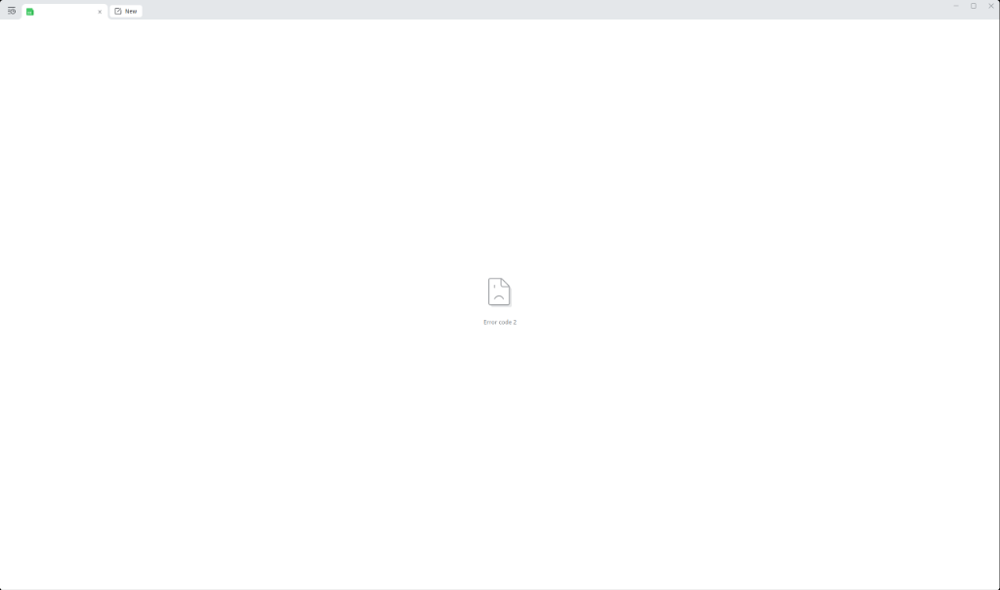

# Omarchy 安装配置 Waydroid 与企业微信（含截图相册自动同步）

> 记录在 Omarchy（Arch Linux + Hyprland / Wayland）上配置企业微信的完整历程：从最初尝试 Wine/Deepin-Wine 方案、深度排查微文档 CEF 内核崩溃（Error code 2）的底层原因，到最终转用 Waydroid Android 容器方案并实现屏幕截图自动同步至相册。

---

## 1. Wine 方案的尝试与踩坑总结（为什么最终放弃 Wine）

在 Linux 桌面上，运行 Windows 版企业微信（`com.qq.weixin.work.deepin` / Deepin-Wine）是社区最常见的做法，但在实际深度配置与日常使用中遇到了以下一系列结构性严重问题，最终证明该方案无法满足稳定办公需求。

### 1.1 Winsxs 0 字节软链接断裂与启动闪退

* **现象**：从 AUR / Spark 仓库安装 `com.qq.weixin.work.deepin` 后，首次启动毫无反应，Wine 进程直接退出。
* **排查与原因**：
  * AUR 打包脚本在解压 7z 容器镜像时，未能正确保留 Windows Winsxs 目录下的相对软链接，导致 `drive_c/windows/winsxs/` 目录下生成了大量 **0 字节空文件**；
  * 当企微主程序 `WXWork.exe` 加载 `DuiLib.dll` 时，调用 `COMCTL32.dll` 报底层错误 `status=c0000020` 并崩溃退出；
  * **修复手段**：必须编写修复脚本，将 `winsxs/` 目录下的所有 DLL 软链接重新修正指向 `../../syswow64`（x86）和 `../../system32`（amd64）。

### 1.2 服务端版本封锁与强制更新

* **现象**：成功启动登录界面并扫码后，微信手机端提示“版本较低，请升级到最新版本后登录”，拒绝进入系统。
* **原因**：腾讯服务端对企业微信桌面端实施严格的版本生命周期管理，打包库中预置的 `5.0.0.6008` 等旧版已被官方服务端下线拦截。
* **解决手段**：必须手动从腾讯官网拉取最新的 Windows 安装包（如 `WeCom_5.0.10.6015.exe`），在 Wine 容器内执行 `/S` 静默覆盖安装升级。但企业微信自带的差分增量升级器（`courgette.exe`）在 Wine 下仍无法平滑自更新，每次大版本更新都需要重新手动维护容器。

### 1.3 Wayland (XWayland) 下窗口阴影纯黑大框遮挡（二维码/验证码无法点击）

* **现象**：
  1. 在 Hyprland 等 Wayland 桌面下打开企业微信时，登录二维码、扫码确认界面以及新设备登录弹出的**短信验证码输入框**四周（或上方）会被一层巨大的**纯黑不透明实心矩形**遮挡；
  2. 黑框遮挡不仅导致无法看清界面文字与验证码输入框，且黑框会抢占焦点拦截鼠标点击与键盘键入，导致无法输入验证码。

* **底层原理分析**：
  1. **Windows 阴影渲染机制**：企业微信使用 `CS_DROPSHADOW` / 分层窗口特效，Wine 在 X11 下为了模拟窗口周围的柔和投影，会额外创建一个**比原窗口大一圈的无标题辅助 X11 窗口（Shadow Window）**，以 32 位 ARGB 格式绘制阴影；
  2. **Wayland 合成器冲突**：在原生 X11 + Picom 合成器下，该辅助窗口能正确进行透明度混合；但在 **Wayland (XWayland)** 环境下，Wayland 合成器无法对 Wine 的伪透明 root 阴影表面进行 Alpha 通道混合，直接将其渲染为**完全不透明的纯黑大色块**；
  3. **层级覆盖**：在平级浮动窗口管理下，该无标题纯黑窗口被错误置顶覆盖在真实的二维码与验证码输入框正上方。
* **临时规避手段（局限性大）**：
  * **Hyprland 规则隐藏**：在 `hyprland.lua` 中为 `title = "^$"` 的 Wine 窗口配置 `opacity = "0 0", no_focus = true`；
  * **X11 脚本守护**：通过 `xdotool` 循环检测尺寸大于 350px 且无标题的 Wine 窗口并执行 `xdotool windowunmap`；
  * **局限**：某些无标题的子功能弹窗会被误杀，且每次窗口重建时仍可能闪烁黑块，体验不够稳定。

### 1.4 核心痛点：微文档/审批/内嵌网页白屏崩溃（Error code 2）

* **现象**：在企业微信中打开微文档（腾讯文档）、工作台审批、邮箱内嵌网页或小程序时，窗口中央显示 Chromium 经典的“哭脸文件图标”以及 **`Error code 2`**，无法加载任何内容。

  
* **逆向与日志排查**：
  1. 通过 Minidump 崩溃转储（`/Crashpad/reports/*.dmp`）与 `libcef.dll` 反汇编分析，崩溃点发生在 `STATUS_BREAKPOINT`（`0x80000003`，即 `int3; ud2` 指令）。
  2. **崩溃根本原因**：企业微信 5.x 内置的 CEF（Chromium 107+）在渲染子进程（`WXWorkWeb.exe --type=renderer`）启动时，调用了 Chromium 的安全防护机制 `base::ProtectedMemory::Initialize()`。该机制调用 Windows API `VirtualProtect` 修改内存页权限，并包含严格断言：
     ```cpp
     CHECK(old_protect == PAGE_READWRITE); // 期望旧权限为 0x04
     ```
  3. 在 Wine / Linux 环境下，Wine 加载 PE 镜像数据段使用的是写时复制映射（`MAP_PRIVATE`），返回的旧保护标志为 `PAGE_WRITECOPY (0x08)` 而非 `0x04`。
  4. 这一断言失败直接导致 Chromium 触发断点终止进程，**Renderer 渲染子进程在启动瞬间直接崩溃**，主界面随之显示 `Error code 2`。
* **尝试过的修复手段（均未彻底解决）**：
  - 切换 Wine 版本（`deepin-wine8-stable` vs `deepin-wine10-stable` vs `wine-staging`）；
  - 修改 `winecfg` Windows 版本模拟（Windows 7 / Windows 10）；
  - 注册表覆盖 Direct3D 渲染器（`renderer=gdi`）；
  - 禁用 GPU 沙箱参数（`--disable-gpu-sandbox`）；
  - **结论**：由于这是编译硬编码进 `libcef.dll` 中的 C++ `CHECK` 逻辑与 Wine 内存映射特性的结构性冲突，除非给 CEF 打补丁重新编译，否则 Windows 版企业微信在 Wine 下无法稳定使用微文档等 Web 视图。

---

## 2. 破局：转用 Waydroid 容器方案

鉴于腾讯官方未提供 Linux 原生桌面版企业微信，而 Android 版企业微信功能与桌面版完全对齐，且内置微文档、微盘、工作台审批、小程序均直接调用 **Android 系统原生 WebView**（不再走 Wine PE 内存映射流程），因此 **Waydroid 成为目前 Linux 下唯一能完整、稳定使用企业微信全部办公功能的方案**。

| 对比维度 | Wine / Deepin-Wine | Waydroid 容器方案 |
| --- | --- | --- |
| **微文档 / 腾讯文档** | ❌ 白屏崩溃（Error code 2） | ✅ 原生 WebView，完美加载协同编辑 |
| **工作台 / 审批 / 小程序** | ❌ 崩溃或无法交互 | ✅ 100% 完整支持 |
| **界面与窗口管理** | ⚠️ XWayland 黑框黑边需脚本抑制 | ✅ Wayland 原生多窗口融合（Multi-window） |
| **网络与稳定性** | ⚠️ 依赖 Wine 模拟层，偶发闪退 | ✅ Linux 容器隔离运行，稳定不崩溃 |
| **剪贴板体验** | 仅文字正常，图片偶发失效 | 原生仅文字，配合自建守护服务实现**截图自动入相册** |

---

## 3. 安装系统依赖

```bash
sudo pacman -S --needed waydroid lxc nftables dnsmasq python-pyclip wl-clipboard
```

组件说明：
- `waydroid`：基于 LXC 的 Linux 原生 Android 容器运行时。
- `lxc` / `nftables` / `dnsmasq`：容器隔离与虚拟网络网桥（`waydroid0`）依赖。
- `python-pyclip` / `wl-clipboard`：Wayland 剪贴板文本与图片事件监听支持。

---

## 4. 部署 Android 系统镜像与初始化

Waydroid 官方镜像托管在 SourceForge，手动下载并放入预置镜像目录可保证部署速度与稳定性：

### 4.1 放置系统与 Vendor 镜像

```bash
# 创建预置镜像目录
sudo mkdir -p /usr/share/waydroid-extra/images

# 下载 LineageOS 20 (Android 13) x86_64 VANILLA 镜像并解压放入
# 将 system.img 和 vendor.img 放置在 /usr/share/waydroid-extra/images/
```

### 4.2 初始化与启动容器服务

```bash
# 初始化配置（指向预置镜像）
sudo waydroid init -i /usr/share/waydroid-extra/images

# 启动并设置开机自启
sudo systemctl enable --now waydroid-container
```

---

## 5. 安装 ARM 转译层（libhoudini / libndk）

企业微信 Android 版包含大量的 ARM 原生 `.so` 库，x86_64 电脑必须安装转译层：

- **Intel CPU**：推荐 `libhoudini`
- **AMD CPU**：推荐 `libndk`

使用 `waydroid_script` 工具注入：

```bash
git clone https://github.com/casualsnek/waydroid_script ~/waydroid_script
cd ~/waydroid_script
python3 -m venv venv
./venv/bin/pip install -r requirements.txt

# Intel CPU 执行：
sudo ./venv/bin/python3 main.py install libhoudini

# AMD CPU 执行：
# sudo ./venv/bin/python3 main.py install libndk
```

---

## 6. 网络与防火墙配置（解决 Network Unavailable 坑）

### 6.1 UFW 防火墙放行路由

Waydroid 默认使用 `waydroid0` 虚拟网桥（`192.168.240.1/24`），若系统启用了 UFW，默认策略会丢弃网桥流量导致 Android 无法联网：

```bash
sudo ufw allow in on waydroid0
sudo ufw route allow in on waydroid0
sudo ufw default allow FORWARD
sudo ufw reload
```

### 6.2 Wi-Fi 状态伪装（Fake WiFi）

企业微信移动端优先检查 Wi-Fi / 移动蜂窝连接，Waydroid 的虚拟以太网会导致其误报“网络断开”，需开启全局 Wi-Fi 伪装：

```bash
waydroid prop set persist.waydroid.fake_wifi "*"
```

### 6.3 优化 Android 连通性检测（Captive Portal）

解决 Android 默认访问 Google 校验服务器超时导致的网络叹号：

```bash
sudo waydroid shell -- settings put global captive_portal_mode 0
sudo waydroid shell -- settings put global captive_portal_https_url https://connect.rom.miui.com/generate_204
```

---

## 7. 多窗口桌面融合模式与安装企业微信

### 7.1 开启独立窗口模式

让 Android 应用作为独立的 Linux 窗口运行，而不是全屏 Android 桌面：

```bash
waydroid prop set persist.waydroid.multi_windows true
```

### 7.2 锁定横屏平板（Pad）双栏模式

默认竖屏在电脑桌面上使用不便。将其锁定为横屏宽屏比例（如 `1600x1000 @ 240 DPI`），企业微信会自动激活 **平板（Pad）双栏界面**（左侧列表、右侧聊天/文档）：

```bash
# 设置横屏窗口几何尺寸与 DPI
waydroid prop set persist.waydroid.width 1600
waydroid prop set persist.waydroid.height 1000
waydroid prop set persist.waydroid.dpi 240

# 在 Android 系统中锁定正向朝向与固定朝向
sudo waydroid shell -- settings put system accelerometer_rotation 0
sudo waydroid shell -- settings put system user_rotation 0
sudo waydroid shell -- wm user-rotation lock 0
sudo waydroid shell -- wm fixed-to-user-rotation enabled
```

### 7.3 安装企业微信 APK

```bash
# 启动 Waydroid 会话
waydroid session start &

# 下载官方 Android APK 并安装
waydroid app install ~/Downloads/wxwork.apk
```

安装完成后，系统桌面应用菜单中会自动生成 `WeCom` / `企业微信` 启动图标。

---

## 8. 屏幕截图自动同步至 Android 相册

由于 Waydroid 原生剪贴板仅支持纯文本，无法跨容器直接把二进制图片数据注入 Android 剪贴板。我们通过 **Wayland 剪贴板事件监听 + MediaScanner 实时广播** 实现全自动图片同步。

### 8.1 配置免密 waydroid shell 执行权限

创建 `/etc/sudoers.d/waydroid-guohh`：

```text
$USER ALL=(ALL) NOPASSWD: /usr/bin/waydroid
```

设置权限：
```bash
sudo chmod 440 /etc/sudoers.d/waydroid-guohh
```

### 8.2 编写截图同步脚本 `~/.local/bin/waydroid-image-sync.sh`

```bash
#!/bin/bash
TARGET_DIR="$HOME/.local/share/waydroid/data/media/0/Pictures/Screenshots"
mkdir -p "$TARGET_DIR"

FILENAME="screenshot_$(date +%Y%m%d_%H%M%S).png"
FILEPATH="$TARGET_DIR/$FILENAME"

# 接收剪贴板图片写入文件
cat > "$FILEPATH"
chmod 666 "$FILEPATH"

# 若 Waydroid 运行中，通知 Android MediaStore 刷新媒体库
if waydroid status 2>/dev/null | grep -q "RUNNING"; then
    sudo waydroid shell -- am broadcast -a android.intent.action.MEDIA_SCANNER_SCAN_FILE -d "file:///sdcard/Pictures/Screenshots/$FILENAME" >/dev/null 2>&1 || true
fi
```

赋予执行权限：
```bash
chmod +x ~/.local/bin/waydroid-image-sync.sh
```

### 8.3 配置 Systemd 用户守护服务 `~/.config/systemd/user/waydroid-clipboard-image-sync.service`

```ini
[Unit]
Description=Waydroid Screenshot and Image Clipboard Sync
After=graphical-session.target

[Service]
Type=simple
ExecStart=/usr/bin/wl-paste --type image/png --watch %h/.local/bin/waydroid-image-sync.sh
Restart=always
RestartSec=3

[Install]
WantedBy=default.target
```

启用并启动服务：
```bash
systemctl --user daemon-reload
systemctl --user enable --now waydroid-clipboard-image-sync.service
```

---

## 9. 日常使用速查

### 9.1 启动与停止

| 操作 | 命令 / 方式 |
| --- | --- |
| **打开企业微信** | 桌面应用菜单点击 `WeCom` 或运行 `waydroid app launch com.tencent.wework` |
| **后台会话启动** | `waydroid session start &` |
| **停止所有容器会话** | `waydroid session stop` |
| **重启容器服务** | `sudo systemctl restart waydroid-container` |

### 9.2 发送屏幕截图

在 Linux 上使用任何截图工具（如 Flameshot、Grim/Slurp、Spectacle）截屏并复制到剪贴板后：
1. 切换到企业微信聊天框；
2. 点击输入框旁的 **「+」号**，会自动浮出 **“你可能要发送的截图”** 预览，直接点击即可发送；
3. 或者点击 **「+」号 ->「相册」**，最新截图排在第一张。

---

## 10. 性能优化与卡顿调优（NVIDIA 独显环境）

### 10.1 为什么会感觉卡顿？（根本原因）
1. **CPU/内存无人为限制**：Waydroid 基于 LXC 容器运行在 Linux 内核上，默认可直接调用宿主机的全部 16 线程 CPU 和全部内存，**并非系统资源配额太小**。
2. **GPU 纯软件渲染瓶颈**：由于本机处于 NVIDIA 独显直连模式，NVIDIA 闭源专有驱动不直接支持 Mesa GBM 容器透传规范，Waydroid 自动降级为 **SwiftShader (CPU 纯软件渲染)**。在高分辨率（4K / 360 DPI）下，所有窗口绘制和动画都由 CPU 逐帧 JIT 计算，因此会产生卡顿感。

### 10.2 优化调优方案

#### 方案一：禁用 Android 系统冗余过渡动画（已生效 ⭐）
关闭 Android 内部窗口与过渡动效，显著减轻 CPU 渲染负担：

```bash
sudo waydroid shell -- settings put global window_animation_scale 0
sudo waydroid shell -- settings put global transition_animation_scale 0
sudo waydroid shell -- settings put global animator_duration_scale 0
sudo waydroid shell -- setprop debug.sf.disable_backpressure 1
sudo waydroid shell -- setprop debug.hwui.render_ahead 1
```

#### 方案二：调优渲染分辨率与 DPI 密度
在高分屏下，适当降低 Waydroid 默认渲染 DPI（例如调为 `240`~`280`），可减少数倍的像素重采样计算量：

```bash
# 调整渲染 DPI（默认 360 降低至 240~280，界面依然清晰但更流畅）
waydroid prop set persist.waydroid.dpi 260
```

#### 方案三：探索 NVIDIA 硬件加速（高级方案）
如果后续需要运行更重度的 Android 图形应用，可引入社区开源的 [`waydroid-nvidia`](https://github.com/Shiro836/waydroid-nvidia) 工具，通过 Vulkan / NVK 代理实现将图形调用转发给 NVIDIA 闭源驱动。

---

## 11. 常见问题排查（FAQ）

### Q1: 提示 "network unavailable" 或 "网络断开"
1. 检查 UFW 路由策略：`sudo ufw default allow FORWARD && sudo ufw reload`
2. 确认 Wi-Fi 伪装已生效：`sudo waydroid shell -- getprop persist.waydroid.fake_wifi`（应输出 `*`）
3. 重启应用：`sudo waydroid shell -- am force-stop com.tencent.wework && waydroid app launch com.tencent.wework`

### Q2: 无法直接 Ctrl+V 粘贴截图
Android 微信/企微发送图片依赖图库相册，不支持直接粘贴 PNG 二进制数据。确保 `waydroid-clipboard-image-sync.service` 处于 active (running) 状态即可自动同步进相册。

### Q3: 声音输出异常
Waydroid 依赖 PulseAudio / PipeWire-Pulse。确保宿主机 `pipewire-pulse` 服务正常运行。

---

## 12. 最终文件清单

```
/usr/share/waydroid-extra/images/
├── system.img                      # Android 13 系统镜像
└── vendor.img                      # Mainline 驱动镜像

/etc/sudoers.d/
└── waydroid-guohh                  # waydroid 命令免密规则

~/.local/bin/
└── waydroid-image-sync.sh          # 剪贴板图片保存与 MediaScanner 广播脚本

~/.config/systemd/user/
└── waydroid-clipboard-image-sync.service  # 剪贴板实时监听守护服务

~/.local/share/applications/
└── waydroid.com.tencent.wework.desktop   # 企业微信桌面快捷方式
```
